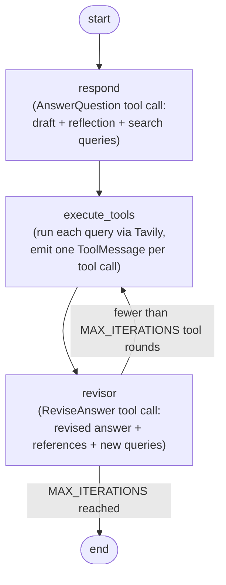

# Deep Research Reflexion Agent

A small, educational [LangGraph](https://langchain-ai.github.io/langgraph/) agent
that answers a question, critiques its own answer, researches the gaps with web
search, and then revises the answer with citations. It runs on IBM
[watsonx.ai](https://www.ibm.com/products/watsonx-ai) (`ChatWatsonx`) and uses
[Tavily](https://tavily.com/) for search.

The project is deliberately compact: a `MessageGraph` with three nodes and one
conditional edge, Pydantic schemas for the model's structured output, and a
fully offline test suite. The application lives in the importable
`deep_research_agent` package under `src/`.

> **Important — medical safety.** The system prompt casts the model as
> "Dr. Paul 'Saladino MD'", a persona that advocates animal-based/carnivore
> nutrition and challenges plant-centric dietary guidance. This one-sided
> framing is a deliberate teaching device inherited from the course material: it
> gives the reflection/revision loop something to critique. The agent's output
> reflects only that prompt and is **not** medical or dietary advice. Do not use
> it for health decisions. See [Limitations](#limitations-and-known-issues).

---

## Table of contents

- [What problem this solves](#what-problem-this-solves)
- [Key features](#key-features)
- [Architecture](#architecture)
- [How the workflow works](#how-the-workflow-works)
- [Technology stack](#technology-stack)
- [Repository structure](#repository-structure)
- [Prerequisites](#prerequisites)
- [Installation](#installation)
- [Environment variables](#environment-variables)
- [Getting watsonx.ai and Tavily credentials](#getting-watsonxai-and-tavily-credentials)
- [Running the project](#running-the-project)
- [Testing](#testing)
- [Optional live smoke tests](#optional-live-smoke-tests)
- [Expected execution behavior](#expected-execution-behavior)
- [Limitations and known issues](#limitations-and-known-issues)
- [Security notes](#security-notes)
- [License](#license)

---

## What problem this solves

A single-shot LLM answer can be shallow, miss important evidence, or assert
things it has not verified. This project demonstrates the **Reflexion**
pattern: instead of trusting the first answer, the agent

1. drafts an answer and critiques it,
2. turns the critique into concrete search queries,
3. retrieves supporting material, and
4. rewrites the answer to incorporate the evidence and cite sources.

It is a reference implementation for learning how to wire a reflective
research loop together with LangGraph, structured tool calls, and external
retrieval.

## Key features

- **Reflection loop built with `MessageGraph`** — three nodes
  (`respond`, `execute_tools`, `revisor`) and one conditional edge.
- **Structured output via Pydantic** — the model must return an
  `AnswerQuestion` / `ReviseAnswer` tool call containing an answer, a nested
  self-critique, a list of search queries, and (for revisions) references.
- **Tool execution node** — runs each generated query through Tavily and returns
  well-formed `ToolMessage` objects linked by `tool_call_id`.
- **Bounded revision loop** — `event_loop` stops after `MAX_ITERATIONS`
  (default 3) rounds of research to guarantee termination.
- **Lazy, import-safe package** — importing `deep_research_agent` never
  authenticates or contacts an external service; the watsonx client is created
  on first use.
- **Installable package** — a `src/` layout with a `pyproject.toml`; install
  with `pip install -e .`.
- **Offline test suite** — 48 `pytest` tests covering schemas, configuration,
  tool execution, chains, graph structure/routing, and a full mocked
  end-to-end run. No credentials or network required.

## Architecture



The diagram above is the logical routing performed by `event_loop`. The
compiled graph is built in `deep_research_agent.graph`
(`build_graph()` / `app`).

## How the workflow works

State is a growing list of chat messages (`MessageGraph`).

1. **`respond`** (`deep_research_agent.responder`) renders `prompt_template`
   with `first_instruction="Provide a detailed ~250 word answer"` and calls the
   LLM bound to the `AnswerQuestion` tool. The reply is an `AIMessage` whose
   single tool call contains:
   - `answer` — the draft,
   - `reflection` — a nested `{missing, superfluous}` self-critique,
   - `search_queries` — 1–3 queries to research the gaps.
2. **`execute_tools`** (`deep_research_agent.execute_tools`) reads the last
   message, and for each `AnswerQuestion` / `ReviseAnswer` tool call runs every
   query in `search_queries` through `TavilySearchResults`. All results for one
   tool call are packed into a single JSON `ToolMessage` keyed by that call's
   `tool_call_id`. A failing query is recorded as an error string instead of
   aborting the run.
3. **`revisor`** (`deep_research_agent.revisor`) receives the accumulated
   messages (including the research `ToolMessage`s) and returns a
   `ReviseAnswer` tool call: a rewritten answer with a `References` section plus
   a fresh set of `search_queries`.
4. **`event_loop`** (`deep_research_agent.event_loop`) counts the `ToolMessage`
   objects in the state. It routes back to `execute_tools` while the count is
   below `MAX_ITERATIONS` (3) and otherwise returns `END`, so the loop always
   terminates.

The initial draft and the final revised answer are extracted from the message
history by `deep_research_agent.graph.extract_answers()`, which returns every
`answer` field in order (draft first, final revision last).

## Technology stack

| Dependency | Role in this project |
|---|---|
| `langgraph` (`MessageGraph`, `END`) | Defines and runs the reflection workflow graph. |
| `langchain-core` | Message types, `ChatPromptTemplate`, runnables, and the `bind_tools` interface. |
| `langchain-ibm` (`ChatWatsonx`) | LangChain integration for IBM watsonx.ai chat models. |
| `ibm-watsonx-ai` | Underlying watsonx.ai SDK used by `langchain-ibm`. |
| `langchain-community` (`TavilySearchResults`) | Web search tool wrapper. |
| `tavily-python` | Tavily API client used by the wrapper. |
| `pydantic` | Schemas (`AnswerQuestion`, `Reflection`, `ReviseAnswer`) that define the model's structured tool calls. |
| `python-dotenv` | Loads credentials from a local `.env` file. |
| `pytest` (dev) | Runs the offline test suite. |

## Repository structure

```
Deep_Research_Reflexion_Agent/
├── src/
│   └── deep_research_agent/
│       ├── __init__.py
│       ├── llm.py            # Lazy ChatWatsonx client (get_llm) + env validation
│       ├── prompt.py         # Shared ChatPromptTemplate (system persona + messages)
│       ├── schema.py         # Pydantic schemas: Reflection, AnswerQuestion, ReviseAnswer
│       ├── search.py         # Tavily tool wrapper (not named tavily.py, to avoid shadowing the `tavily` package)
│       ├── execute_tools.py  # "execute_tools" node: runs search_queries via Tavily
│       ├── responder.py      # "respond" node: draft answer + critique + queries
│       ├── revisor.py        # "revisor" node: revised answer + references + queries
│       ├── event_loop.py     # Conditional routing: continue or stop (MAX_ITERATIONS)
│       └── graph.py          # Builds/compiles the MessageGraph; module entry point
├── tests/
│   ├── conftest.py           # Seeds placeholder env; keeps the suite offline
│   ├── test_prompt.py
│   ├── test_tool_call.py
│   ├── test_schema.py
│   ├── test_config.py
│   ├── test_execute_tools.py
│   ├── test_chains.py
│   ├── test_graph.py
│   └── test_end_to_end.py
├── scripts/
│   └── render_graph.py       # Standalone utility: renders the graph to graph_plot.png (needs network)
├── .env.example              # Template for required environment variables
├── .gitignore
├── README.md
├── pyproject.toml            # Build/packaging config (setuptools, src layout) + pytest config
├── requirements.txt          # Runtime dependencies
└── requirements-dev.txt      # Runtime + test dependencies
```

## Prerequisites

- **Python 3.12** (developed and tested on 3.12.14).
- An IBM Cloud account with a watsonx.ai project (for live runs only).
- A Tavily account (for live runs only).
- The default test suite needs **neither** credentials nor internet access.

## Installation

```bash
git clone https://github.com/AlaaBadawii/IBM-RAG-Agentic-AI.git
cd IBM-RAG-Agentic-AI/Agentic_AI_with_LangChain_and_LangGraph/Deep_Research_Reflexion_Agent

python3.12 -m venv .venv
source .venv/bin/activate        # Windows: .venv\Scripts\activate

pip install -r requirements.txt       # runtime dependencies
pip install -r requirements-dev.txt   # ...plus test dependencies
pip install -e .                      # install this package (editable)
```

`pip install -e .` installs the `deep_research_agent` package. Runtime
dependencies are read from `requirements.txt` by `pyproject.toml`, so they are
not duplicated: the distribution is named `deep-research-reflexion-agent`
while the importable package is `deep_research_agent`.

## Environment variables

Copy the template and fill in your own values:

```bash
cp .env.example .env
```

`.env.example` contains placeholders only:

```dotenv
WATSONX_API_KEY=ADD_API_KEY_HERE
WATSONX_PROJECT_ID=ADD_PROJECT_ID_HERE
WATSONX_PROJECT_NAME=ADD_PROJECT_NAME_HERE
WATSONX_URL=https://eu-de.ml.cloud.ibm.com
WATSONX_MODEL_ID=ibm/granite-4-h-small
TAVILY_API_KEY=ADD_TAVILY_API_KEY_HERE
```

| Variable | Used by | Notes |
|---|---|---|
| `WATSONX_API_KEY` | `deep_research_agent.llm` | Required. Your IBM Cloud API key. |
| `WATSONX_PROJECT_ID` | `deep_research_agent.llm` | Required. The watsonx.ai project ID. |
| `WATSONX_URL` | `deep_research_agent.llm` | Required. Regional endpoint (e.g. `https://eu-de.ml.cloud.ibm.com`). |
| `WATSONX_MODEL_ID` | `deep_research_agent.llm` | Required. Model that supports tool calling. |
| `WATSONX_PROJECT_NAME` | *(informational)* | Present in the template for reference; not read by the code. |
| `TAVILY_API_KEY` | `deep_research_agent.search` | Required for any run that executes research. |

If a required watsonx variable is missing, `get_llm()` raises an `OSError` naming
the missing variables and pointing at `.env.example`; importing
`deep_research_agent.search` raises a similar `OSError` for a missing
`TAVILY_API_KEY`.

## Getting watsonx.ai and Tavily credentials

**IBM watsonx.ai**

1. Create a free IBM Cloud account: <https://cloud.ibm.com/registration>.
2. Create a watsonx.ai instance: <https://cloud.ibm.com/catalog/services/watsonx-ai>.
3. In the watsonx.ai console, create a project and open **Manage → General** to
   copy the **Project ID** (`WATSONX_PROJECT_ID`).
4. Create an **API key** from your IBM Cloud account (Manage → Access (IAM) →
   API keys) and use it as `WATSONX_API_KEY`.
5. Set `WATSONX_URL` for your region and `WATSONX_MODEL_ID` to a tool-calling
   capable model (the template uses `ibm/granite-4-h-small`).

**Tavily**

1. Sign up at <https://tavily.com/signup>.
2. Copy the API key from your Tavily dashboard into `TAVILY_API_KEY`.

## Running the project

Activate the virtual environment, install the package (`pip install -e .`), and
make sure `.env` is populated first. Run modules with `python -m` from the
repository root:

```bash
# Full reflection workflow (live watsonx.ai + Tavily calls)
python -m deep_research_agent.graph

# Render the compiled graph to graph_plot.png (requires network access)
python scripts/render_graph.py

# Individual components (each performs a live call)
python -m deep_research_agent.llm         # smoke-test the watsonx client
python -m deep_research_agent.search      # smoke-test the Tavily wrapper
python -m deep_research_agent.responder   # prompt for a question; prints the structured tool call
```

`python -m deep_research_agent.graph` takes no arguments; edit the `question`
value in the module's `if __name__ == "__main__":` block to change the question.

## Testing

The default suite is **fully offline**. `tests/conftest.py` seeds placeholder
credentials before importing the package, individual tests mock the LLM and
Tavily, and `tests/test_config.py` verifies (in a subprocess with the network
and the watsonx client booby-trapped) that importing the project does not touch
the network. Pytest is configured in `pyproject.toml` with `testpaths = ["tests"]`.

```bash
pip install -r requirements-dev.txt
pip install -e .
python -m pytest -q
```

Coverage areas:

| File | What it covers |
|---|---|
| `tests/test_schema.py` | `Reflection` / `AnswerQuestion` / `ReviseAnswer` validation, nested fields, list typing. |
| `tests/test_config.py` | Missing-environment error messages, lazy/cached client construction, import safety (no network). |
| `tests/test_execute_tools.py` | Single/multiple queries, multiple tool calls, empty/unsupported calls, search-error handling, correct `search_queries` argument (regression). |
| `tests/test_chains.py` | Responder/revisor bind the expected tools and instructions; chains are built lazily. |
| `tests/test_prompt.py` | Prompt renders the system/human/system structure and the requested instructions. |
| `tests/test_tool_call.py` | Pydantic schemas convert to the expected tool JSON schemas. |
| `tests/test_graph.py` | Graph compiles, entry point and edges are correct, routing stops at `MAX_ITERATIONS`, answer extraction is order-correct. |
| `tests/test_end_to_end.py` | Full mocked run: stages execute in order, research reaches the revisor, the loop terminates, final answer is returned, no real API is called. |

## Optional live smoke tests

The default suite never contacts a provider. If you want to exercise the real
integrations, the module `__main__` blocks are opt-in live checks that require
valid credentials in `.env` and network access:

```bash
python -m deep_research_agent.llm     # one real watsonx.ai completion
python -m deep_research_agent.search  # one real Tavily search
python -m deep_research_agent.graph   # one full live reflection run
```

These are intentionally **not** collected by `pytest` and will fail without
credentials.

## Expected execution behavior

Running `python -m deep_research_agent.graph` prints the initial draft, then the
final revised answer (the code prints these exact markers):

```
--- Initial Draft Answer ---
<the model's initial draft answer>

--- Final Revised Answer with References ---
<the model's final revised answer, including a References section>
```

The exact text depends on the model and the search results and is not
deterministic. Internally the run produces a message sequence of the form
`Human → AIMessage(draft) → ToolMessage → AIMessage(rev1) → ToolMessage → …`
with one `ToolMessage` per research round and up to `MAX_ITERATIONS` revisions.

## Limitations and known issues

- **Biased persona / not medical advice.** The system prompt is intentionally
  one-sided (animal-based/carnivore nutrition). The reflection step critiques
  the *draft*, but the agent does not verify medical claims and does not
  represent a balanced or clinically validated view. This is the most important
  limitation of the project.
- **`MessageGraph` is a legacy LangGraph API.** It works with the pinned
  `langgraph==0.2.57`; newer LangGraph versions favor `StateGraph`. This project
  keeps `MessageGraph` intentionally and pins the version accordingly.
- **Fixed iteration count.** `MAX_ITERATIONS = 3` in
  `deep_research_agent.event_loop` is a constant; the number of revisions is not
  configurable at runtime.
- **Sequential search.** `execute_tools` runs queries one at a time and has no
  retry/backoff; provider rate limits or transient failures surface as error
  strings in the tool message.
- **Community Tavily wrapper.** `deep_research_agent.search` uses
  `langchain_community.tools.tavily_search.TavilySearchResults`; LangChain now
  also ships a dedicated `langchain-tavily` integration.
- **Importing the graph needs a Tavily key.** `deep_research_agent.search`
  validates `TAVILY_API_KEY` at import, so importing
  `deep_research_agent.graph` requires that variable to be set (config
  validation only; no network call is made).
- **Graph image needs network.** `scripts/render_graph.py` calls
  `draw_mermaid_png()`, which contacts a remote renderer.
- **No tracing/checkpointing.** The graph runs without a checkpointer or
  LangSmith tracing.

Possible future improvements: make the iteration limit and word target
configurable, parallelize searches with retries, add optional checkpointer/
tracing, migrate to `StateGraph`, and add an opt-in live integration test marked
with `pytest` markers.

## Security notes

- **Never commit `.env` or any real credential.** `.env` and `.env.*` are
  gitignored; only `.env.example` (placeholders) is tracked.
- Keep API keys out of source, notebooks, logs, and screenshots.
- If a key is ever exposed, rotate it in the IBM Cloud and Tavily consoles.
- The `.venv/`, `__pycache__/`, `*.egg-info/`, and `.pytest_cache/` directories
  are gitignored and should not be committed.

## License

No license file is included in this repository. Unless the repository owner
adds one, the code is **all rights reserved** by default and should not be
treated as open source or reused without permission.
