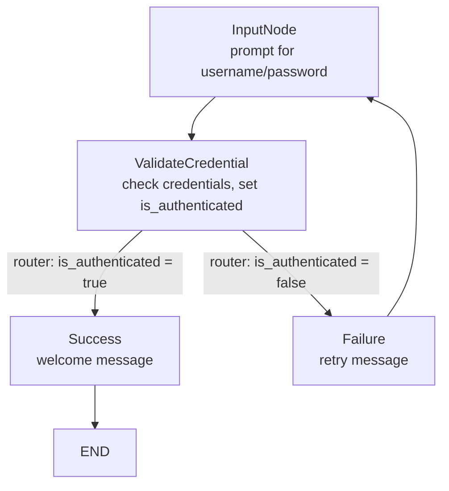
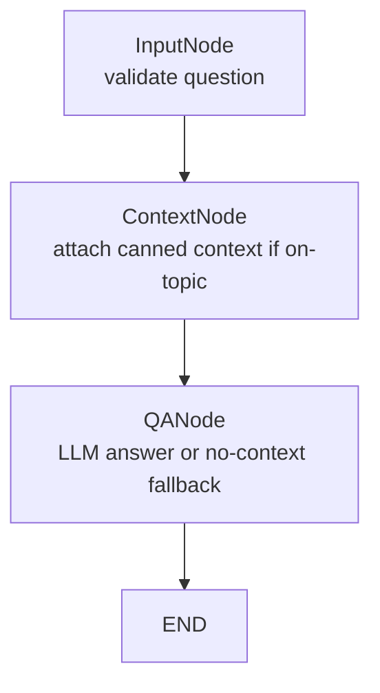

# LangGraph Stateful AI Workflows

Two small stateful agent workflows built with LangGraph: a credential-checking
authentication loop and a context-grounded question-answering chain backed by
IBM watsonx.ai.

Course project: **Agentic AI with LangChain and LangGraph** (IBM RAG and
Agentic AI Professional Certificate). Rebuilt locally from the
`LangGraph101-v1` lab notebook.

## Overview

LangGraph models an agent as a **graph of nodes that read and write a shared
state object**. Nodes do the work, edges define the order, and conditional
edges let the graph branch or loop based on the current state. That loop
capability is the key difference from plain linear (DAG-only) chains: the
workflow can retry, re-route, or refine instead of running once straight
through.

This project demonstrates the pattern twice:

1. **Authentication workflow** (`states.py` + `graph.py`, run via `app.py`) —
   prompts for credentials, validates them, and either welcomes the user or
   loops back to retry.
2. **QA workflow** (`QAState.py`) — validates a question, attaches canned
   context when the question is about LangGraph / the guided project, and
   asks an IBM watsonx.ai chat model to answer from that context.

## Learning objectives

Each concept below is implemented in this repo (not just mentioned in the
lab text):

- **State schemas** — `AuthState` and `QAState` as `TypedDict`s that define
  exactly which keys each workflow carries between nodes.
- **Nodes** — plain Python functions `(state) -> dict` (`input_node`,
  `validate_credentials_node`, `success_node`, `failure_node`,
  `input_validation_node`, `context_provide_node`, `llm_qa_node`).
- **Graph construction** — `StateGraph(StateClass)`, `add_node`,
  `set_entry_point`, `compile()`.
- **Edges** — fixed transitions with `add_edge` (e.g. `InputNode →
  ValidateCredential`, `QANode → END`).
- **Conditional routing** — `add_conditional_edges` with a `router` function
  that reads `is_authenticated` and branches to success or retry.
- **Cyclic graphs** — the auth workflow loops `Failure → InputNode`, so a
  failed login retries instead of terminating.
- **Workflow execution** — `app.invoke(inputs)` runs the compiled graph from
  the entry point to `END` and returns the final state.
- **State transitions** — each node returns a partial dict that is merged
  into the shared state (e.g. `{"is_authenticated": True}`).
- **LLM integration** — `ChatWatsonx` from `langchain-ibm`, configured from
  environment variables in `llm.py` and called inside the `QANode`.

The notebook additionally walks through a **counter exercise** (increment /
print nodes with a stop-condition conditional edge). The exercise cells are
left as `#TODO` stubs with the solutions shown in the surrounding markdown —
they are study material, not implemented code.

## How the project works

### Authentication workflow

Input (`{"username": ...}`) enters at `InputNode`, which prompts for the
missing username/password via `input()`. `ValidateCredential` compares them
against the demo credentials and writes `is_authenticated`. The `router`
conditional edge then branches: success goes to `Success` (writes a welcome
message, then `END`); failure goes to the failure node (writes a retry
message) and loops back to `InputNode`.



> Note: in `graph.py` the failure node is registered under the name
> `"Failuer"` (a typo in the lab code). It works because the router mapping
> uses the same name; the diagram above uses the intended spelling.

### QA workflow

Input (`{"question": ...}`) enters at `InputNode`
(`input_validation_node`), which flags empty questions. `ContextNode`
(`context_provide_node`) attaches a canned LangGraph description when the
question mentions "langgraph" or "guided project", otherwise sets context to
`None`. `QANode` (`llm_qa_node`) builds a `Context + Question` prompt and
calls the watsonx.ai chat model; with no context it returns a fixed
"I don't have enough context" fallback instead of calling the model.



## Project structure

```
LangGraph_Stateful_AI_Workflows/
├── LangGraph101-v1.ipynb  # Lab notebook: theory, both workflows step by step, counter exercise
├── states.py              # AuthState schema + auth node/router functions
├── graph.py               # Auth StateGraph wiring (nodes, edges, conditional edges, entry point)
├── app.py                 # Compiles the auth workflow; CLI entry point (prompts for password)
├── QAState.py             # QAState schema + QA nodes + QA graph; also runnable (needs watsonx.ai)
├── llm.py                 # ChatWatsonx client configured from environment variables
├── requirements.txt
├── .env.example
└── README.md
```

- The **notebook** is the learning record: it builds each workflow cell by
  cell (states → nodes → edges → compile → invoke) with demo credentials and
  example questions. It currently has no stored cell outputs.
- The **Python modules** are the standalone, importable version of the same
  two workflows. `states.py`/`graph.py`/`app.py` form the auth app;
  `QAState.py` (with `llm.py`) is the self-contained QA app.

## Technologies used

- **LangGraph** (`langgraph==0.2.57`) — `StateGraph`, nodes, edges,
  conditional edges, `compile`/`invoke`.
- **LangChain IBM integration** (`langchain-ibm==0.3.10`) — `ChatWatsonx`
  chat model.
- **IBM watsonx.ai** — hosted LLM inference (any model your project can
  access; the lab default is `meta-llama/llama-4-maverick-17b-128e-instruct-fp8`).
- **ibm-watsonx-ai** — underlying SDK (transitive dependency).
- **python-dotenv** — loads `.env` for local runs.
- **Jupyter** — for running the notebook (use your own install; not pinned
  in `requirements.txt`).

No web UI, API server, vector store, or agent framework beyond LangGraph is
used. The "LLM" in the auth workflow is simulated (a hard-coded credential
comparison); only the QA workflow calls a real model.

## Setup and installation

Prerequisites: Python 3.11+ and your own IBM watsonx.ai access (API key +
project) for the QA workflow. The auth workflow needs no credentials.

```bash
cd LangGraph_Stateful_AI_Workflows

python3 -m venv .venv
source .venv/bin/activate

pip install -r requirements.txt

cp .env.example .env
# edit .env with your own values (QA workflow only)
```

Required variables for the QA workflow (see `.env.example`):

- `WATSONX_API_KEY` — your watsonx.ai API key (**required**)
- `WATSONX_PROJECT_ID` — your watsonx.ai project ID (**required**)
- `WATSONX_PROJECT_NAME` — your project name (read at startup; not passed
  to the model client)
- `WATSONX_URL` — service URL, e.g. `https://us-south.ml.cloud.ibm.com`
- `WATSONX_MODEL_ID` — model ID, e.g.
  `meta-llama/llama-4-maverick-17b-128e-instruct-fp8`

Never commit a filled-in `.env` — it is git-ignored. The notebook needs no
`.env` by itself; only importing `llm.py` / running `QAState.py` does.

## Configuration

`llm.py` loads the five variables above with `load_dotenv()` and raises
`OSError` at import time if any is missing. It then builds a single shared
client:

```python
llm = ChatWatsonx(
    apikey=SecretStr(api_key),
    project_id=project_id,
    url=SecretStr(url),
    model_id=model_id,
)
```

To switch models, change `WATSONX_MODEL_ID` — no code edit needed. You need
a watsonx.ai account with permission to invoke the chosen model in the given
project/region.

## Running the project

Auth workflow (no IBM credentials needed — interactive, prompts for a
password):

```bash
python app.py
```

With `{"username": "test_user"}` as the initial input, enter
`secure_password` at the prompt to see the success path; anything else takes
the failure → retry loop. Example final state on success:

```python
{'username': 'test_user', 'password': 'secure_password',
 'is_authenticated': True, 'output': 'Authentication successful! Welcome.'}
```

QA workflow (needs a working `.env` and network access to watsonx.ai):

```bash
python QAState.py
```

Runs the example `{"question": "What is LangGraph?"}` through
validate → context → LLM and prints the final state including `answer`.
An off-topic question (e.g. `"What is the weather today?"`) returns the
no-context fallback without calling the model.

Notebook:

```bash
jupyter notebook LangGraph101-v1.ipynb
```

Run cells top to bottom. Cells that call `input()` (auth demo) prompt inline;
the watsonx.ai cells need credentials configured as shown in the notebook's
"Running Locally" section.

## Key concepts and takeaways

- **State is the contract.** The `TypedDict` fixes which keys exist; every
  node reads what it needs and returns only its updates. Debugging a
  LangGraph app starts with printing the state between nodes.
- **Routing is just a function of state.** The `router` reads one boolean
  and returns a branch key — conditional edges map those keys to nodes.
  Keeping routing logic separate from node logic makes flows easy to follow.
- **Cycles enable retries.** The `Failure → InputNode` edge is the whole
  point of the auth demo: the graph stays alive until the exit condition
  (successful auth) is met.
- **Gate expensive calls behind cheap checks.** The QA graph validates input
  and resolves context before ever invoking the LLM, with an explicit
  fallback when there is nothing to ground the answer on. That ordering —
  validate → enrich → generate — transfers directly to larger agents.
- **Partial state updates merge.** Nodes never rebuild the whole state;
  returning `{"answer": ...}` leaves `question`/`context` intact, which is
  what makes multi-node flows composable.

## Limitations and future improvements

- Demo credentials are hard-coded (`test_user` / `secure_password`) with no
  hashing, storage, or real auth — fine for learning routing, unsuitable for
  anything real.
- `input()` inside a node blocks and cannot work in non-interactive or web
  contexts; a next step is passing all inputs to `invoke()` or adding a
  proper interface.
- Context matching is keyword-based (`"langgraph"` / `"guided project"` in
  the question) — retrieval over real documents would be the natural upgrade.
- No persistence, streaming, or error recovery: no checkpointer, no
  `stream()`, and the LLM node catches only `(ValueError, TypeError,
  RuntimeError)`.
- The counter exercise exists only as notebook stubs + markdown solutions;
  implementing it as a runnable module would round out the set.
- Minor lab-code quirks preserved as-is: the `"Failuer"` node name in
  `graph.py`, and `QAState.py`'s validation node returning `valid`/`error`
  keys that are not part of the `QAState` schema.

## Learning-project disclaimer

Educational project built while studying LangGraph and stateful agentic
workflows through the IBM `LangGraph101-v1` learning lab. It demonstrates
core LangGraph mechanics on toy problems — it is not a production-ready
agent platform.
