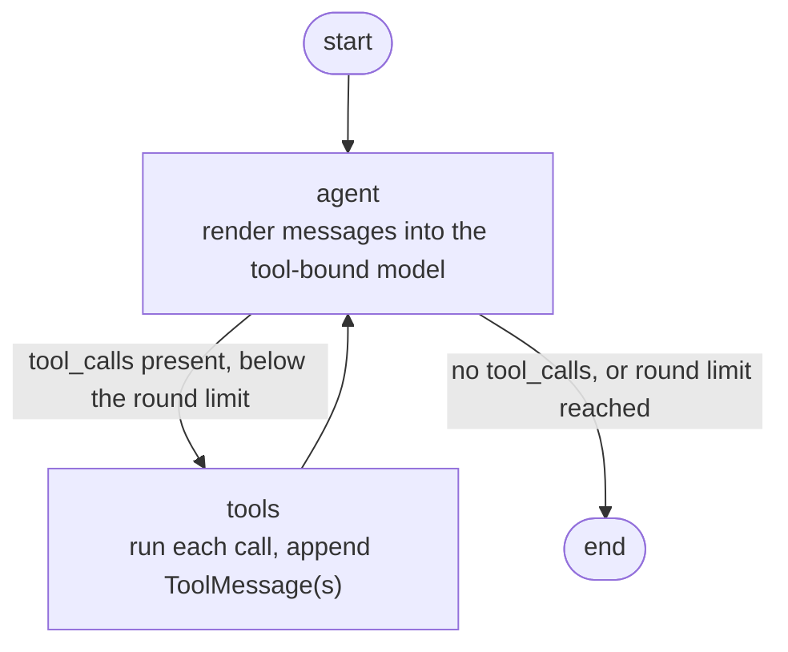

# ReAct Agent with LangGraph

An educational, offline-testable **ReAct** agent built with
[LangChain](https://python.langchain.com/),
[LangGraph](https://langchain-ai.github.io/langgraph/) message/state utilities,
and IBM [watsonx.ai](https://www.ibm.com/products/watsonx-ai) (`ChatWatsonx`).
Web search is provided by [Tavily](https://tavily.com/).

The project is deliberately small: a two-node `StateGraph` with one conditional
edge, a handful of tools, and a fully offline `pytest` suite. It exists to make
the ReAct loop explicit and to show how the pieces of a modern agent fit
together -- and where the sharp edges are.

---

## Table of contents

- [Learning objectives](#learning-objectives)
- [The ReAct pattern](#the-react-pattern)
- [Features and tools](#features-and-tools)
- [Execution flow](#execution-flow)
- [State, prompt, tool calls, results and termination](#state-prompt-tool-calls-results-and-termination)
- [Technology stack](#technology-stack)
- [Repository structure](#repository-structure)
- [Prerequisites](#prerequisites)
- [Installation](#installation)
- [Environment variables](#environment-variables)
- [Getting watsonx.ai and Tavily credentials](#getting-watsonxai-and-tavily-credentials)
- [Running the agent](#running-the-agent)
- [Testing](#testing)
- [Example interactions](#example-interactions)
- [Known limitations](#known-limitations)
- [Security notes](#security-notes)
- [License](#license)

---

## Learning objectives

After reading and running this project you should be able to:

1. Explain the ReAct cycle (reason -> act -> observe -> repeat) and build it as
   a LangGraph `StateGraph`.
2. Explain what `bind_tools()` does **and does not** do: it advertises tools to
   the model; it never executes them.
3. Connect a model's `tool_calls` to `ToolMessage` results by `tool_call_id`,
   and explain why that link matters.
4. Add a **bounded** iteration limit so an agent cannot loop forever.
5. Write a **safe** calculator that evaluates user/model input without
   `eval()`.
6. Treat external search content as untrusted data and summarize it without
   inventing missing metadata.
7. Keep a project **import-safe** (no client, no network, no credentials needed
   at import time) and test it entirely offline with mocks.

## The ReAct pattern

ReAct interleaves a model's reasoning with tool use. Rather than answering in
one shot, the agent repeatedly decides whether it needs a tool:

```text
user question
   -> model "thinks" and, if useful, requests a tool (a tool_call)
   -> the graph executes the tool and records the result (a ToolMessage)
   -> the model sees the result and decides again
   -> ... until the model produces a final answer (no more tool calls)
```

Two details are easy to get wrong and are handled deliberately here:

- **The model does not run tools.** `model.bind_tools(tools)` only tells the
  provider which tools exist and how to format a request. The graph's `tools`
  node is what actually calls Python.
- **The loop must be bounded.** A model can keep asking for tools indefinitely.
  `should_continue` stops the run once the configured number of tool rounds is
  reached.

## Features and tools

- **Two-node ReAct graph** with one conditional edge (`agent`, `tools`).
- **Bounded loop** via `REACT_MAX_ITERATIONS` (default 6).
- **Resilient tool execution**: unknown tools, malformed arguments, and tool
  failures all become visible `Error: ...` tool messages instead of crashing
  the run.
- **String-coerced tool results**: tool output is always sent back to
  watsonx.ai as a string, avoiding the API error
  `The Json field 'type' is required`.
- **Lazy, import-safe design**: the watsonx.ai client, the Tavily client, and
  the ReAct chain are all created on first use.
- **Five registered tools**:

  | Tool | Purpose | External calls |
  |---|---|---|
  | `search_tool` | Web search via Tavily | Yes |
  | `remommend_clothing` | Keyword-based clothing advice | No |
  | `calculator` | Safe arithmetic (AST-restricted) | No |
  | `news_summarizer` | Grounded summary of search results | Uses watsonx.ai |

- **Offline test suite** -- 83 `pytest` tests, no credentials or network.

## Execution flow



- `agent` -- `react_agent.call_model`
- `tools` -- `react_agent.tool_execution`
- routing -- `react_agent.should_continue`

The compiled graph is built in `react_agent.graph` (`build_graph()` and the
module-level `graph`).

## State, prompt, tool calls, results and termination

**State** (`react_agent.agent_state`) is a `TypedDict` with a single
`messages` field annotated with LangGraph's `add_messages` reducer. Returning
`{"messages": [m]}` from a node *appends* `m` to the history instead of
replacing the list, so every node sees the full conversation.

**Prompt** (`react_agent.prompt`) is a `ChatPromptTemplate`: a system message
followed by `MessagesPlaceholder("scratch_pad")`. `call_model` renders it with
`{"scratch_pad": state["messages"]}`, so the history lands in the placeholder.
The system prompt asks for concise, result-focused answers and explicitly does
**not** demand disclosure of private chain-of-thought.

**Tool calls** (`react_agent.model_react`) are produced by
`chat_prompt | get_llm().bind_tools(tools)`. An `AIMessage` carrying
`tool_calls` means the model wants a tool; an `AIMessage` without them is the
final answer.

**Tool results** (`react_agent.tool_execution`) are `ToolMessage` objects. Each
one echoes the originating `tool_call_id`, which is how the model associates a
result with the request that produced it. The node looks each tool up by name,
validates that arguments are an object, runs the tool, and serializes any
non-string result to JSON text.

**Termination** (`react_agent.should_continue`) ends the run when the last
message has no tool calls. Otherwise it counts completed tool rounds
(`ToolMessage`s in the history) and stops once `REACT_MAX_ITERATIONS` is
reached -- the guarantee that the loop always terminates.

## Technology stack

| Dependency | Role in this project |
|---|---|
| `langgraph` (`StateGraph`, `END`, `add_messages`) | Defines and runs the ReAct graph and message state. |
| `langchain-core` | Message types, `ChatPromptTemplate`, runnables, `bind_tools`. |
| `langchain` (`langchain.tools.tool`) | The `@tool` decorator used by every tool. |
| `langchain-ibm` (`ChatWatsonx`) | LangChain integration for IBM watsonx.ai. |
| `ibm-watsonx-ai` | Underlying watsonx.ai SDK. |
| `langchain-community` (`TavilySearchResults`) | Web search tool wrapper. |
| `tavily-python` | Tavily API client. |
| `pydantic` | Message validation and data models. |
| `python-dotenv` | Loads credentials from `.env`. |
| `pytest` (dev) | Runs the offline test suite. |

## Repository structure

```text
ReAct_Agent_with_LangChain_and_LangGraph/
├── src/
│   └── react_agent/
│       ├── __init__.py
│       ├── agent_state.py      # AgentState + add_messages reducer
│       ├── llm.py              # Lazy, cached ChatWatsonx client + env validation
│       ├── prompt.py           # ChatPromptTemplate (system + scratch_pad placeholder)
│       ├── model_react.py      # Lazy `prompt | model.bind_tools(tools)` chain
│       ├── call_model.py       # "agent" node
│       ├── tool_execution.py   # "tools" node + result stringification
│       ├── should_continue.py  # conditional edge + iteration limit
│       ├── graph.py            # builds/compiles the StateGraph
│       └── tools/
│           ├── __init__.py     # tool registry (tools, tools_by_name)
│           ├── web_search.py   # search_tool (Tavily, lazy client)
│           ├── clothing.py     # remommend_clothing (keyword advice)
│           ├── arithmetic.py   # calculator (safe AST evaluator)
│           └── summarizer.py   # news_summarizer (grounded summaries)
├── scripts/
│   ├── run_agent.py            # main streaming demo (live calls)
│   ├── manual_react.py         # the ReAct loop written out by hand (live calls)
│   └── render_graph.py         # renders graph_plot.png (needs network)
├── tests/
│   ├── conftest.py
│   ├── test_config.py
│   ├── test_prompt.py
│   ├── test_state.py
│   ├── test_model_react.py
│   ├── test_search_tool.py
│   ├── test_tool_execution.py
│   ├── test_should_continue.py
│   ├── test_calculator.py
│   ├── test_news_summarizer.py
│   ├── test_graph.py
│   └── test_end_to_end.py
├── .env.example
├── .gitignore
├── README.md
├── graph_plot.png              # rendered graph (regenerate with scripts/render_graph.py)
├── pyproject.toml
├── requirements-dev.txt
└── requirements.txt
```

Tool **module** names (`web_search`, `clothing`, `arithmetic`, `summarizer`)
differ from their tool **function** names. Importing a function into
`react_agent.tools` would otherwise shadow the submodule of the same name.

## Prerequisites

- **Python 3.12** (developed and verified on 3.12.14).
- An IBM Cloud account with a watsonx.ai project (live runs only).
- A Tavily account (live runs only).
- The default test suite needs **neither** credentials nor internet.

## Installation

```bash
cd Agentic_AI_with_LangChain_and_LangGraph/ReAct_Agent_with_LangGraph

python3.12 -m venv .venv
source .venv/bin/activate        # Windows: .venv\Scripts\activate

pip install -r requirements-dev.txt   # runtime + test dependencies
pip install -e .                      # install the react_agent package (editable)
```

`pyproject.toml` reads runtime dependencies from `requirements.txt`, so they
are not duplicated: the distribution is named `react-agent-langgraph` while the
importable package is `react_agent`.

> **Running the tests without installing.** The suite also runs directly from a
> source checkout: `pyproject.toml` sets `pythonpath = ["src"]` for pytest, so
> `pip install -e .` is convenient but not required to run `pytest`.

## Environment variables

```bash
cp .env.example .env
```

`.env.example` contains placeholders only:

```dotenv
WATSONX_API_KEY=ADD_API_KEY_HERE
WATSONX_PROJECT_ID=ADD_PROJECT_ID_HERE
WATSONX_PROJECT_NAME=ADD_PROJECT_NAME_HERE
WATSONX_URL=https://eu-de.ml.cloud.ibm.com
WATSONX_MODEL_ID=ibm/granite-4-h-small
TAVILY_API_KEY=ADD_TAVILY_API_KEY_HERE
```

| Variable | Used by | Notes |
|---|---|---|
| `WATSONX_API_KEY` | `react_agent.llm` | Required. Your IBM Cloud API key. |
| `WATSONX_PROJECT_ID` | `react_agent.llm` | Required. The watsonx.ai project ID. |
| `WATSONX_URL` | `react_agent.llm` | Required. Regional endpoint. |
| `WATSONX_MODEL_ID` | `react_agent.llm` | Required. A tool-calling-capable model. |
| `WATSONX_PROJECT_NAME` | *(informational)* | Present in the template; not read by the code. |
| `TAVILY_API_KEY` | `react_agent.tools.web_search` | Required to run `search_tool`. |
| `REACT_MAX_ITERATIONS` | `react_agent.should_continue` | Optional. Tool-round limit (default 6). |

A missing watsonx variable makes `get_llm()` raise an `OSError` naming the
variable(s) and pointing at `.env.example`. A missing `TAVILY_API_KEY` makes
`search_tool` raise a similar `OSError` **when invoked**; importing the package
never requires it.

## Getting watsonx.ai and Tavily credentials

**IBM watsonx.ai**

1. Create a free IBM Cloud account: <https://cloud.ibm.com/registration>.
2. Create a watsonx.ai instance: <https://cloud.ibm.com/catalog/services/watsonx-ai>.
3. In the watsonx.ai console, open your project's **Manage -> General** page and
   copy the **Project ID**.
4. Create an **API key** (Manage -> Access (IAM) -> API keys) for
   `WATSONX_API_KEY`.
5. Set `WATSONX_URL` for your region and `WATSONX_MODEL_ID` to a model that
   supports tool calling (the template uses `ibm/granite-4-h-small`).

**Tavily**

1. Sign up at <https://tavily.com/signup>.
2. Copy the API key from your Tavily dashboard into `TAVILY_API_KEY`.

## Running the agent

Activate the environment, install the package, and populate `.env`, then run
from the repository root:

```bash
# Main demo: streams each graph step (live watsonx.ai + Tavily)
python scripts/run_agent.py

# The same ReAct loop written out by hand, for learning (live calls)
python scripts/manual_react.py

# Render the compiled graph to graph_plot.png (needs network)
python scripts/render_graph.py

# Component smoke tests (each performs a live call)
python -m react_agent.llm                       # one watsonx.ai completion
python -m react_agent.tools.web_search          # one Tavily search
python -m react_agent.tools.summarizer          # one summarization
```

Change the question by editing `QUESTION` in `scripts/run_agent.py`, or pass a
`HumanMessage` to the compiled graph yourself:

```python
from langchain_core.messages import HumanMessage
from react_agent.graph import graph

result = graph.invoke({"messages": [HumanMessage(content="What is sqrt(16) + 2 ** 3?")]})
print(result["messages"][-1].content)
```

## Testing

The default suite is **fully offline**: `tests/conftest.py` seeds placeholder
credentials before importing the package, the model and Tavily are mocked, and
`tests/test_config.py` verifies in a subprocess (with sockets blocked and the
watsonx client booby-trapped) that importing the project touches no network.

```bash
pip install -r requirements-dev.txt
python -m pytest -q
```

Result in this repository: **83 passed**.

| File | Covers |
|---|---|
| `tests/test_config.py` | Missing-env errors, lazy/cached client, import safety. |
| `tests/test_prompt.py` | Placeholder wiring, system-prompt behaviour. |
| `tests/test_state.py` | `add_messages` append and update semantics. |
| `tests/test_model_react.py` | Chain is cached and binds every tool. |
| `tests/test_search_tool.py` | Missing-key error, delegated search. |
| `tests/test_tool_execution.py` | Linking, multiple calls, unknown/malformed/error handling. |
| `tests/test_should_continue.py` | Routing and the iteration limit. |
| `tests/test_calculator.py` | Arithmetic, functions, rejected syntax, complexity limits, no code execution. |
| `tests/test_news_summarizer.py` | Empty input, metadata marking, grounding prompt, errors. |
| `tests/test_graph.py` | Graph compiles with the expected nodes/edges. |
| `tests/test_end_to_end.py` | Full mocked cycle, unknown-tool path, loop limit. |

**Live integration tests** are the `__main__` blocks in each module and the
`scripts/` entry points. They are **not** collected by `pytest` and require real
credentials and network access.

## Example interactions

The model decides which tools to call. Typical prompts and what happens:

**Weather + clothing** (calls `search_tool`, then `remommend_clothing`):

```text
user: What's the weather like in Zurich, and what should I wear based on the temperature?
agent -> search_tool(query="current weather Zurich")
tools -> [search results]
agent -> remommend_clothing(weather="...")
tools -> "Bring a raincoat and waterproof shoes."
agent -> final answer
```

**Calculator** (a single `calculator` call):

```text
user: What is (2 + 3) * 4?
agent -> calculator(expression="(2 + 3) * 4")
tools -> "20"
agent -> "(2 + 3) * 4 = 20"
```

`calculator` also understands `sqrt(16)`, `sin(pi / 2)`, `2 ** 3`, `10 % 3`,
and the constants `pi`, `e`, `tau`. Anything outside the allowed syntax (an
import, an attribute access, a comprehension, ...) is rejected, returning an
`Error: ...` string.

**News summarizer** (pass search results as JSON):

```text
user: Summarize the latest news about X.
agent -> search_tool(query="X news")
tools -> [search results]
agent -> news_summarizer(articles="[{...search results...}]")
tools -> "Article 1: <headline> | Date: (not provided) | Source: <url> | ..."
agent -> grounded summary
```

The summarizer labels missing dates/URLs as `(not provided)` and is instructed
never to invent facts, dates, or sources.

## Known limitations

- **`remommend_clothing` is misspelled** in the function (and therefore tool)
  name. It is kept as-is so the model-facing tool name does not change; the
  advice itself is simple keyword matching, not real forecasting.
- **Search tool ordering is not guaranteed.** Registering `search_tool` and
  `news_summarizer` does not make the agent run them in sequence automatically;
  the model decides what to call and when.
- **Search results are passed to the summarizer as a string.** The tool accepts
  a JSON string (or plain text), which is robust across models but means the
  model must serialize the search output.
- **Sequential tool execution.** The `tools` node runs calls one at a time, and
  a call that raises is reported (not retried).
- **Community Tavily wrapper.** This project uses
  `langchain_community.tools.tavily_search.TavilySearchResults`; LangChain also
  ships a dedicated `langchain-tavily` integration.
- **Graph image needs network.** `scripts/render_graph.py` calls
  `draw_mermaid_png()`, which contacts a remote renderer.
- **No checkpointing or tracing.** The graph runs without a checkpointer or
  LangSmith tracing.
- **Live edges depend on the model.** Because a live model chooses the tools,
  end-to-end tool sequences are not deterministic.

Possible future work: parallelize tool calls with retries; migrate the
summarizer to a structured tool schema; add optional checkpointing; add an
opt-in live integration test marked with a pytest marker.

## Security notes

- **Never commit `.env` or a real credential.** `.env` and `.env.*` are
  gitignored; only `.env.example` (placeholders) is tracked. If a key leaks,
  rotate it in the IBM Cloud and Tavily consoles.
- **The calculator does not use `eval()`.** It parses the expression with
  `ast` and evaluates an explicitly allowed subset (operators, functions,
  constants), rejecting imports, attribute access, comprehensions, and
  arbitrary calls. Complexity and length are bounded, and powers are capped.
- **Search content is untrusted.** Web results can contain text crafted to
  manipulate the model. The system prompt tells the model to treat tool output
  as data, not instructions, but this is a mitigation, not a guarantee.
- **Tool arguments are validated.** Malformed arguments, unknown tools, and tool
  exceptions are turned into `Error:` messages rather than executed blindly.

## License

No license file is included in this repository. Unless the repository owner adds
one, the code is **all rights reserved** by default and should not be treated as
open source or reused without permission.
