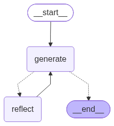
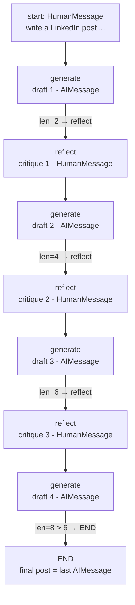

# Reflection Agent with LangGraph

A two-node **generate → reflect loop** built with LangGraph that drafts a
LinkedIn post and iteratively refines it from its own critique, backed by
IBM watsonx.ai.

Course project: **Agentic AI with LangChain and LangGraph** (IBM RAG and
Agentic AI Professional Certificate). Built locally from the reflection-agent
lab pattern (generation chain + reflection chain wired into a message graph).

## Overview

Instead of generating once, the agent alternates between two roles that share
one message list as state:

1. **Generate** (`generation_node`) — writes the best LinkedIn post it can
   for the user's request, revising previous attempts when critique is
   present in the history.
2. **Reflect** (`reflection_node`) — critiques the latest draft as a LinkedIn
   content strategist (quality, structure, tone, engagement potential,
   formatting, call-to-action) and returns actionable feedback.

The critique is appended as a `HumanMessage`, so the next generation step
reads it as user feedback and produces a refined draft. A conditional edge
caps the loop: after 4 generations the graph terminates and the last
`AIMessage` is the final post.



## Learning objectives

Each concept below is implemented in this repo:

- **Message-passing state** — `MessageGraph()` keeps a `Sequence[AnyMessage]`
  as the shared state; every node appends one message.
- **Nodes** — plain functions `(state) -> list[Message]` (`generation_node`,
  `reflection_node`), each invoking an LCEL chain (`prompt | llm`).
- **LCEL chains** — `generation_chain` and `reflection_chain` in `chains.py`
  (`ChatPromptTemplate` + `MessagesPlaceholder("messages")` piped into the
  shared `ChatWatsonx` client).
- **Role-played prompts** — `prompts.py`: a drafting system prompt vs. a
  6-point strategist rubric (quality, structure/tone, engagement,
  relevance, formatting/hashtags, call-to-action).
- **Fixed edge** — `reflect → generate`, so every critique triggers a
  revision.
- **Conditional routing** — `should_continue` on the `generate` node:
  `len(state) > 6 → END`, else `→ reflect`. This yields 4 drafts and 3
  critiques per run (see trace below).
- **Feedback as message type** — the reflector returns a `HumanMessage`
  while the generator returns an `AIMessage`, so critique reads as new user
  input on the next pass.
- **Workflow execution** — `workflow = graph.compile()`,
  `workflow.invoke(HumanMessage(...))` runs entry → loop → `END`.
- **LLM integration** — `ChatWatsonx` from `langchain-ibm`, configured from
  environment variables in `llm.py` (fail-fast `OSError` on missing vars).
- **Graph visualization** — `graph_plot.py` renders the compiled graph via
  `workflow.get_graph().draw_mermaid_png()` to `reflection_graph.png`.
- **Lab notebook retained** — `Tweet-Reflection-Agent-v1.ipynb` is the course
  lab this rebuild follows (Skills Network `skills-network` project
  placeholder, no stored outputs, no credentials).

## How the project works

The `__main__` example asks for a LinkedIn post about getting a software
developer job at IBM (under 160 characters). Message-count trace, starting
from 1 `HumanMessage`:



The caller takes `response[-1].content` as the final post.

## Project structure

```
Reflection_Agent_with_LangGraph/
├── Tweet-Reflection-Agent-v1.ipynb  # Lab notebook: theory + step-by-step build (no stored outputs)
├── graph.py               # MessageGraph wiring + nodes + router + __main__ demo
├── chains.py              # generation_chain / reflection_chain (prompt | llm)
├── prompts.py             # generation_prompt + reflection_prompt templates
├── llm.py                 # ChatWatsonx client from environment variables
├── graph_plot.py          # renders workflow graph to reflection_graph.png
├── reflection_graph.png   # compiled graph diagram
├── requirements.txt
├── .env.example
└── README.md
```

## Technologies used

- **LangGraph** (`langgraph==0.2.57`) — `MessageGraph`, nodes, fixed +
  conditional edges, `compile`/`invoke`.
- **LangChain core** (transitive via `langchain-ibm`) — `ChatPromptTemplate`,
  `MessagesPlaceholder`, `AIMessage`/`HumanMessage`.
- **LangChain IBM integration** (`langchain-ibm==0.3.10`) — `ChatWatsonx`
  chat model.
- **IBM watsonx.ai** — hosted LLM inference (this project uses
  `ibm/granite-4-h-small`; any model your project can access works).
- **ibm-watsonx-ai** (`==1.8.0`) — underlying SDK (transitive dependency).
- **python-dotenv** (`==1.2.4`) — loads `.env` for local runs.

No vector store, retriever, web UI, or multi-agent framework is used. The
whole agent is the two-node loop above.

## Setup and installation

Prerequisites: Python 3.11+ and IBM watsonx.ai access (API key + project).

```bash
cd Reflection_Agent_with_LangGraph

python3 -m venv .venv
source .venv/bin/activate

pip install -r requirements.txt

cp .env.example .env
# edit .env with your own values
```

Required variables (see `.env.example`):

- `WATSONX_API_KEY` — your watsonx.ai API key (**required**)
- `WATSONX_PROJECT_ID` — your watsonx.ai project ID (**required**)
- `WATSONX_PROJECT_NAME` — your project name (read at startup; not passed
  to the model client)
- `WATSONX_URL` — service URL, e.g. `https://eu-de.ml.cloud.ibm.com`
- `WATSONX_MODEL_ID` — model ID, e.g. `ibm/granite-4-h-small`

Never commit a filled-in `.env` — it is git-ignored (root `.gitignore` plus
the local one in this folder).

## Configuration

`llm.py` loads the five variables above with `load_dotenv()` and raises
`OSError` at import time if any is missing, naming exactly which ones. It
then builds a single shared client imported by `chains.py`:

```python
llm = ChatWatsonx(
    apikey=SecretStr(api_key),
    project_id=project_id,
    url=SecretStr(url),
    model_id=model_id,
)
```

To switch models, change `WATSONX_MODEL_ID` — no code edit needed. You need
a watsonx.ai account with permission to invoke the chosen model in the given
project/region.

## Running the project

Generate the demo post (needs a working `.env` and network access to
watsonx.ai — each run makes ~7 model calls: 4 generations + 3 reflections):

```bash
python graph.py
```

Prints the final LinkedIn post (the last `AIMessage` in the state).

Regenerate the architecture diagram (needs network access — Mermaid image
rendering is a remote call):

```bash
python graph_plot.py
```

Writes `reflection_graph.png`.

To try your own topic, edit the `HumanMessage(content=...)` in the
`__main__` block of `graph.py`, e.g.:

```python
inputs = HumanMessage(
    content="Write a linkedin post on finishing an AI agents course under 160 characters"
)
```

## Key concepts and takeaways

- **Reflection beats single-shot generation.** A cheap critique pass
  (structure, tone, engagement, CTA) gives the generator concrete revision
  targets instead of hoping the first draft is good.
- **Message types are control flow.** Returning critique as `HumanMessage`
  is what makes the generator treat it as feedback — the same history
  window serves as both memory and instruction.
- **Bound the loop explicitly.** `len(state) > 6` is a simple, auditable stop
  condition: cost is predictable (7 LLM calls), and the graph always
  terminates. A quality-based stop (e.g. "reflect until score ≥ X") would be
  the natural next step.
- **Separate prompts, shared model.** Both chains use the same `llm` object;
  behavior differences come entirely from the system prompts — an easy
  pattern to extend (e.g. add a style-guide chain or a fact-check chain).
- **Validate config at import.** Raising `OSError` with the missing variable
  names in `llm.py` fails fast before any graph code runs.

## Limitations and future improvements

- `MessageGraph` state is an untyped message list — there is no schema
  (unlike `StateGraph` with a `TypedDict`), so nothing stops a node from
  appending the wrong type.
- The stop condition counts messages, not quality — the 4th draft is
  returned even if the 2nd was better; no scoring, ranking, or early exit.
- No persistence, streaming, or error recovery: no checkpointer, no
  `stream()`, no retry around model calls.
- The "under 160 characters" constraint lives only in the user message, not
  in validation — the generator can (and sometimes will) exceed it.
- `graph_plot.py` depends on remote Mermaid rendering
  (`draw_mermaid_png`); it fails offline.
- Minor lab-code quirk preserved: the `# Complining the workflow` comment
  typo in `graph.py`.

## Learning-project disclaimer

Educational project built while studying reflection-pattern agents through
the IBM Agentic AI with LangChain and LangGraph course. It demonstrates the
generate-critique-revise loop on a toy copywriting task — it is not a
production content pipeline.
