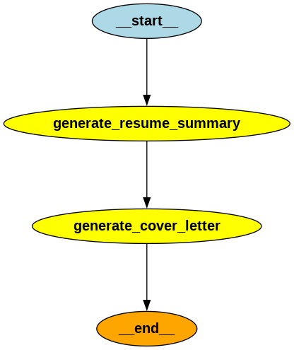
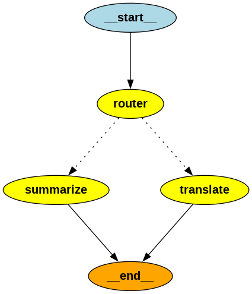
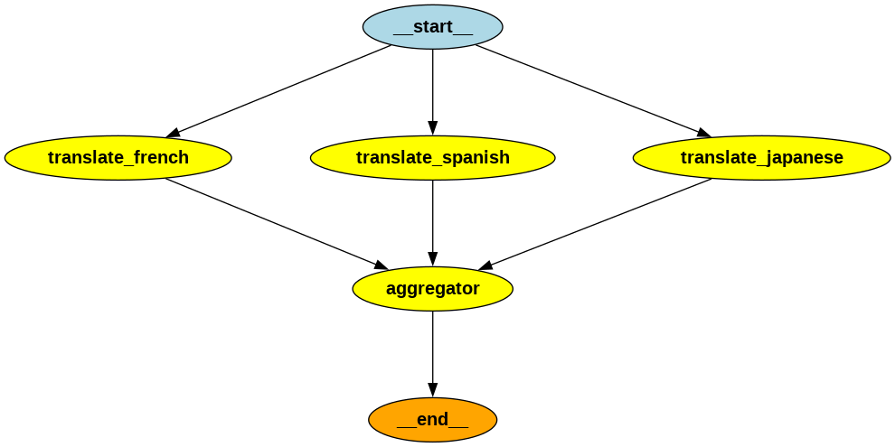

# LangGraph Workflow Patterns

An educational project demonstrating three foundational agent workflow patterns built with
[LangGraph](https://langchain-ai.github.io/langgraph/) and IBM **watsonx.ai** models:

1. **Sequential agent coordination** — a chain of agents executed in a fixed order.
2. **Intent-based routing** — a classifier node that fans out to specialized agents.
3. **Parallel agent execution** — independent agents run concurrently, with results merged by an aggregator.

This is a course lab / learning aid, **not** a production-ready agent platform.

## Learning objectives

- Build and compile `StateGraph` workflows in LangGraph.
- Understand `set_entry_point` / `set_finish_point`, `add_edge`, and `add_conditional_edges`.
- Fan work out from `START` to parallel nodes and merge results back in a single aggregator node.
- Use `ChatWatsonx` from `langchain-ibm` as the LLM for every node.
- Inspect and visualize compiled workflow structure (`graph.png` per workflow).

## The three workflow patterns

### 1. Sequential agent coordination

A strictly ordered pipeline, useful when each step depends on the previous step's output.

```
START ──> generate_resume_summary ──> generate_cover_letter ──> END
```

- **Input state**: `job_description` (string).
- **Step 1** summarizes the ideal candidate's qualifications from the job description (`resume_summary`).
- **Step 2** writes a personalized cover letter from that summary + the job description (`cover_letter`).
- `agent.py` prints the generated `resume_summary` to the console.



### 2. Intent-based routing

Useful when one entry point must dispatch to different specialized agents based on user intent.

```
              ┌──> summarize ──┐
START ──> router              (END)
              └──> translate ──┘
```

- **Input state**: `user_input` (string).
- **`router`** invokes a watsonx.ai model bound to a `Router` tool-scheme (`pydantic` model) and
  classifies the request as `summarize` or `translate`. If the model answers with plain text
  instead of a tool call, the response text is parsed as a fallback.
- A conditional edge function (`router.py`) returns the value of `task_type`, which LangGraph
  maps to the matching node name.
- `agent.py` runs two sample inputs (one `translate`, one `summarize`) and prints the output and
  the classified task type.



### 3. Parallel agent execution

Useful for independent, long-running tasks that can be executed concurrently to reduce latency.

```
         ┌──> translate_french ────┐
START ───┼──> translate_spanish ───┼──> aggregator ──> END
         └──> translate_japanese ──┘
```

- **Input state**: `text` (string).
- All three translation agents start concurrently from `START`; each writes its own key
  (`french`, `spanish`, `japanese`) and then joins at the aggregator, which combines everything
  into `combined_output`.
- `agent.py` prints the full final state dictionary.



## Project structure

```text
LangGraph-Workflow-Patterns/
├── 01-sequential-agent-coordination/
│   ├── agent.py                    # entry point: runs the workflow with a sample job description
│   ├── chain_state.py              # TypedDict state schema
│   ├── generate_cover_letter.py    # node: writes cover letter
│   ├── generate_resume_summary.py  # node: summarizes job description
│   ├── graph.py                    # workflow definition (prints info, renders graph.png)
│   └── graph.png                   # visualization of the compiled graph
├── 02-intent-based-routing/
│   ├── agent.py                    # entry point: runs summarize + translate sample inputs
│   ├── graph.py                    # workflow definition with conditional edges
│   ├── llm_router.py               # tool-bound classifier model + Router pydantic scheme
│   ├── router.py                   # conditional edge function
│   ├── router_node.py              # node: classifies intent (tool call with text fallback)
│   ├── router_state.py             # TypedDict state schema
│   ├── summarize_node.py           # node: summarization agent
│   ├── translate_node.py           # node: French translation agent
│   └── graph.png                   # visualization of the compiled graph
├── 03-parallel-agent-execution/
│   ├── agent.py                    # entry point: runs the parallel translation workflow
│   ├── aggregator.py               # node: merges the three translations
│   ├── graph.py                    # workflow definition with parallel edges
│   ├── state.py                    # TypedDict state schema
│   ├── translate_french.py         # node: French translation agent
│   ├── translate_japanese.py       # node: Japanese translation agent
│   ├── translate_spanish.py        # node: Spanish translation agent
│   └── graph.png                   # visualization of the compiled graph
├── llm.py                          # shared watsonx.ai ChatWatsonx client (lazy, cached)
├── print_workflow_info.py          # utility: prints nodes/edges, can render graph.png
├── render_graphs.py                # renders graph.png for all three workflows
├── requirements.txt                # direct dependencies (tested versions)
└── .env.example                    # template for watsonx.ai credentials
```

## Prerequisites

- Python **3.12** (the environment this project was developed and tested in).
- An IBM Cloud account with a **watsonx.ai** project and API key/model access.
- For graph rendering only: **Graphviz** (system package, e.g. `sudo apt install graphviz`) and
  the `pygraphviz` Python package (listed as an optional, commented entry in `requirements.txt`).

## Setup

```bash
cd LangGraph-Workflow-Patterns

# create and activate a virtual environment (Python 3.12)
python3.12 -m venv venv
source venv/bin/activate

pip install -r requirements.txt
```

## IBM watsonx.ai configuration

All three workflows use `ChatWatsonx` configured through environment variables via `llm.py`.
Copy the template and fill in **your own** values (never commit the resulting `.env`):

```bash
cp .env.example .env
# then edit .env with your credentials
```

| Variable            | Purpose                                              | Example value (placeholder)                      |
|---------------------|------------------------------------------------------|--------------------------------------------------|
| `WATSONX_API_KEY`   | IBM Cloud IAM API key                                | `your-watsonx-api-key`                           |
| `WATSONX_PROJECT_ID`| watsonx.ai project GUID                              | `your-watsonx-project-id`                        |
| `WATSONX_URL`       | watsonx.ai endpoint for your region                  | `https://your-region.ml.cloud.ibm.com`           |
| `WATSONX_MODEL_ID`  | Model identifier                                     | `ibm/granite-3-8b-instruct`                      |

`llm.py` validates these variables on first use and calls `load_dotenv()`, so a project-root
`.env` file is picked up automatically. The `ChatWatsonx` client is constructed lazily and cached
(`lru_cache`); importing modules does not call the LLM.

## Running the workflows

Each workflow is run by its `agent.py` (make sure `venv` is activated and `.env` is configured):

```bash
python 01-sequential-agent-coordination/agent.py
python 02-intent-based-routing/agent.py
python 03-parallel-agent-execution/agent.py
```

Each run sends real prompts to your watsonx.ai account (**billable API usage**).

**Illustrative outputs** (real model output varies):

- Workflow 01 prints a resume summary paragraph derived from the job description.
- Workflow 02 prints, for each sample input, the generated answer and the classified task type:

  ```
  ========= test translate =========
  <French translation of "I love programming?">
  translate
  ========= test summarize =========
  <one-sentence summary>
  summarize
  ```

- Workflow 03 prints the full final state dictionary containing `text`, `french`, `spanish`,
  `japanese`, and `combined_output`.

## Graph inspection and rendering

Every workflow's `graph.py` prints its nodes and edges when executed directly:

```bash
python 01-sequential-agent-coordination/graph.py
python 02-intent-based-routing/graph.py
python 03-parallel-agent-execution/graph.py
```

To (re)render the `graph.png` visualization for **all three compiled graphs** at once:

```bash
python render_graphs.py
```

PNG files are written next to each workflow's `graph.py` and are referenced from this README.
Rendering is fully local (Graphviz/`pygraphviz`) and does **not** call the LLM; however, importing
the workflow 01 and 02 node modules *does* require the watsonx environment variables to be set
(no requests are made — client construction only).

## Troubleshooting

- **`Missing required environment variables: ...`** — copy `.env.example` to `.env` and fill in
  all four watsonx variables. The `.env` must live in the project root (`load_dotenv` default).
- **`ImportError: attempted relative import with no known parent package` or `ModuleNotFoundError`
  for `llm`, `chain_state`, etc.** — the folders start with digits and hyphens, so they cannot be
  imported as regular packages; run the provided `agent.py`/`graph.py`/`render_graphs.py` entry
  points directly from the project root instead of importing them from arbitrary locations.
- **`ModuleNotFoundError: No module named 'langgraph'` / `'langchain_ibm'`** — activate your
  virtual environment and run `pip install -r requirements.txt`.
- **Graph rendering fails with `Install pygraphviz to draw graphs`** — install the system
  Graphviz package and `pip install pygraphviz`. On Debian/Ubuntu:
  `sudo apt install graphviz && pip install pygraphviz`.
- **401/403 errors or `project_id` errors from watsonx.ai** — verify your API key, URL region,
  and that the API key has access to the project ID you provided.

## Security notes

- Never commit `.env` or any real API key; `.gitignore` excludes it.
- `.env.example` contains placeholders only.
- Every workflow run sends your prompt text to IBM watsonx.ai. Model invocations may incur costs
  depending on your watsonx.ai plan — review your quota before repeated runs.
- TLS certificate verification is not disabled anywhere in this project's code; if your
  environment requires a custom CA bundle, configure it at the system/`httpx` level rather than
  bypassing verification.

## Testing and validation status

- ✅ All three workflow graphs compile successfully.
- ✅ Workflows 01 and 02 were executed end-to-end against a live watsonx.ai account
  (`ibm/granite-4-h-small`); outputs matched the expected formats above.
- ✅ Workflows 03's graph was compiled and rendered; a full end-to-end run has **not** been
  re-verified as part of repository preparation.
- ✅ All three `graph.png` files were rendered from the compiled graphs using
  `pygraphviz`/Graphviz (local rendering, no external image service).
- ❌ There are no automated unit tests in this repository; validation was performed manually.
- The pinned dependency versions were validated against the development environment
  (Python 3.12.14); other versions are untested.

## Acknowledgments

Based on a hands-on lab about workflow patterns with agent frameworks (prompt chaining,
routing, and parallelization), ported to IBM watsonx.ai.
