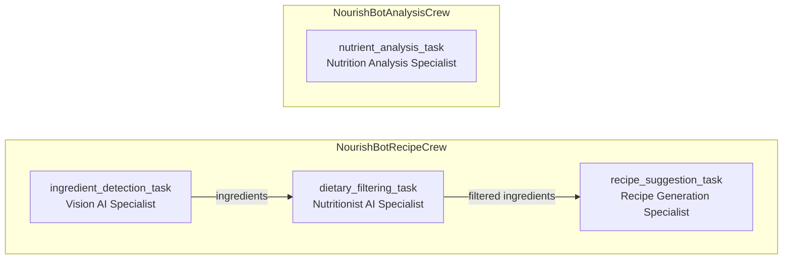

# NourishBot — A CrewAI Multi-Agent Nutrition Assistant

**Status: Implemented guided CrewAI lab; local reasoning-model configuration remains separate from tool credentials.**

**Course 8 — IBM RAG and Agentic AI Professional Certificate.** [Course overview](../README.md) · [Certificate](../../README.md)

> This project is part of my work in the **IBM RAG & Agentic AI Professional
> Certificate**. It is an educational lab and portfolio piece, not a production
> system.

NourishBot is an educational **multi-agent system (MAS)** built with
[CrewAI](https://docs.crewai.com/) and IBM **watsonx.ai**. It accepts a food
image and either:

1. **Generates recipe ideas** from detected ingredients, optionally filtered by
   a dietary restriction, or
2. **Analyzes a plated dish** and returns an estimated calorie and nutrient
   breakdown with a short health evaluation.

As part of my certificate work, I used this lab to practice role-based agent
design, task dependencies, tool integration, structured outputs, and context
passing between agents. The project is intended for learning and portfolio
demonstration — **not** production use.

## What it does

| Workflow | Input | What happens | Output |
|---|---|---|---|
| **Recipe** | Image of fridge/pantry contents + optional dietary restriction | Detects ingredients, filters them against the restriction, then generates recipes | Markdown recipe cards with ingredients, instructions, and calorie estimates |
| **Analysis** | Image of a complete dish | Runs a vision-based nutritional assessment | Dish name, portion size, calories, macronutrient/micronutrient tables, health evaluation |

The Gradio UI is in `app.py`; the agent and task wiring is in `src/crew.py`;
prompts live in `src/config/agents.yaml` and `src/config/tasks.yaml`.

## Architecture

NourishBot defines **four agents** and **four tasks**, then composes them into
two crews that share a common base class.



### Agents

| Agent | Role | Tools | Responsibility |
|---|---|---|---|
| `ingredient_detection_agent` | Vision AI Specialist | `ExtractIngredientsTool`, `FilterIngredientsTool` | Identify ingredients in an image and normalize the raw list |
| `dietary_filtering_agent` | Nutritionist AI Specialist | `DietaryFilterTool` | Remove ingredients that conflict with the user's restriction |
| `nutrient_analysis_agent` | Nutrition Analysis Specialist | `NutrientAnalysisTool` | Estimate calories and break down nutrients for a dish |
| `recipe_suggestion_agent` | Recipe Generation Specialist | — | Produce structured recipe ideas from the filtered ingredients |

Agent personas, goals, and backstories are declarative YAML. Tool access and
iteration limits are set in Python (`src/crew.py`), which keeps orchestration
concerns separate from prompt content.

### Tasks and dependencies

| Task | Agent | Depends on | Structured output |
|---|---|---|---|
| `ingredient_detection_task` | `ingredient_detection_agent` | — | Raw/normalized ingredient list |
| `dietary_filtering_task` | `dietary_filtering_agent` | `ingredient_detection_task` via `context` | Filtered ingredient list |
| `nutrient_analysis_task` | `nutrient_analysis_agent` | — | `NutrientAnalysisOutput` |
| `recipe_suggestion_task` | `recipe_suggestion_agent` | `dietary_filtering_task` via `context` | `RecipeSuggestionOutput` |

The recipe crew runs sequentially:

```text
ingredient_detection_task -> dietary_filtering_task -> recipe_suggestion_task
```

The analysis crew runs a single task:

```text
nutrient_analysis_task
```

## How information flows

1. `app.py` saves the uploaded image to a temporary directory and builds a
   `kickoff(inputs=...)` dictionary containing `uploaded_image`,
   `dietary_restrictions`, and `workflow_type`.
2. CrewAI interpolates those inputs into the YAML task descriptions and agent
   goals (for example, `{uploaded_image}` and `{dietary_restrictions}`).
3. Each agent decides when to call its tools. Vision tools encode the image as
   base64 and send it to a watsonx.ai multimodal model.
4. Downstream tasks receive the previous task's output through CrewAI's
   `context=[...]` mechanism. This makes the dependency explicit and allows
   CrewAI to order tasks correctly.
5. The final task uses `output_json` with a Pydantic model, so the result is
   validated and structured. `app.py` converts the crew result to a dictionary
   and renders it as Markdown.

### Why `context` instead of custom dependency fields

The original lab scaffold passed `depends_on` and `input_data` to `Task`. Those
are not CrewAI `Task` fields, so they were silently ignored. This version uses
the supported `context=[...]` API, which is the idiomatic way to declare task
dependencies and pass prior task output.

## Tools

| Tool | Model | Purpose |
|---|---|---|
| `ExtractIngredientsTool.extract_ingredient` | `meta-llama/llama-3-2-90b-vision-instruct` | Read a food image and return visible ingredients |
| `FilterIngredientsTool.filter_ingredients` | — | Split, trim, and lowercase a raw ingredient string |
| `DietaryFilterTool.filter_based_on_restrictions` | `ibm/granite-4-h-small` | Remove ingredients that violate a dietary restriction |
| `NutrientAnalysisTool.analyze_image` | `meta-llama/llama-3-2-90b-vision-instruct` | Estimate portions, calories, nutrients, and healthiness |

The vision tools share a small helper for reading local paths or URLs and
encoding images, which avoids duplicated model-call code.

## Structured outputs

`src/models.py` defines the schemas used by CrewAI's `output_json`:

- `RecipeSuggestionOutput` → a list of `Recipe` objects (`title`, `ingredients`,
  `instructions`, `calorie_estimate`).
- `NutrientAnalysisOutput` → `dish`, `portion_size`, `estimated_calories`,
  `nutrients` (`NutrientBreakdown`), and `health_evaluation`.

This gives the Gradio formatters stable fields instead of parsing free-form
model text.

## Project structure

```text
NourishBot/
├── app.py                       # Gradio UI, output formatting, crew invocation
├── src/
│   ├── __init__.py
│   ├── crew.py                  # CrewBase classes: agents, tasks, crews
│   ├── models.py                # Pydantic output schemas
│   ├── tools.py                 # CrewAI tools wrapping watsonx.ai
│   ├── watsonx.py               # Environment-driven watsonx.ai configuration
│   └── config/
│       ├── agents.yaml          # Agent roles, goals, backstories
│       └── tasks.yaml           # Task descriptions and expected outputs
├── examples/                    # Sample food images for the UI
├── demo.mp4                     # Short walkthrough of the app
├── requirements.txt             # Frozen lab environment export
├── .env.example                 # Credential template
├── .gitignore
└── README.md
```

## Setup

### Prerequisites

- Python 3.10+ (required by the type-hint syntax used in this version)
- An IBM Cloud account with watsonx.ai access, **or** access to the IBM Skills
  Network lab environment
- Network access to the watsonx.ai endpoint

### Install

```bash
cd Agentic_AI_with_LangGraph_CrewAI_AutoGen_and_BeeAI/NourishBot

python3 -m venv .venv
source .venv/bin/activate        # Windows: .venv\Scripts\activate

python -m pip install -r requirements.txt
```

### Configure credentials

```bash
cp .env.example .env
```

Then edit `.env`:

```dotenv
WATSONX_API_KEY=your_api_key
WATSONX_URL=https://us-south.ml.cloud.ibm.com
WATSONX_PROJECT_ID=your_project_id
```

`src/watsonx.py` loads `.env` from the project root. If `WATSONX_API_KEY` is
empty, credentials are created without an explicit key for ambient lab auth.
URL and project ID independently fall back to the Skills Network defaults.
For the **tools** in a personal IBM Cloud project, set all three values.

These variables do not configure the CrewAI agents' reasoning model: the agents
have no explicit `llm` assignment. The full local workflow also needs the
default-model configuration supplied by the lab or a separate model-wiring change.
`WATSONX_MODEL_ID` is not read; vision/text tool IDs are fixed in `src/watsonx.py`.

> Never commit `.env`. It is excluded by `.gitignore`.

## Usage

Start the app:

```bash
python app.py
```

Open <http://127.0.0.1:5000> in your browser.

1. **Recipe workflow** — upload a fridge/pantry image, enter a restriction such
   as `vegan` or `keto`, select `recipe`, and click **Analyze**.
2. **Analysis workflow** — upload a plated-dish image, leave the restriction
   blank, select `analysis`, and click **Analyze**.
3. Use the example images in `examples/` to autofill the inputs.

A short walkthrough is included in [`demo.mp4`](demo.mp4).

The Gradio interface accepts images as PIL objects, saves each request to a
temporary directory, and deletes it after the crew finishes.

## Key dependencies

The project was built around these direct dependencies (from
`requirements.txt`):

- `crewai==0.75.0`
- `crewai-tools==0.17.0`
- `gradio==5.12.0`
- `ibm_watsonx_ai==1.1.20`
- `langchain==0.3.4`
- `pydantic==2.10.5`
- `python-dotenv==1.0.1`

`requirements.txt` is a frozen export from the lab environment. It is kept as-is
for reproducibility; dependency versions were not changed during the polishing
pass.

## Design decisions

- **Two crews instead of one branching crew.** Recipe generation and nutritional
  analysis have different inputs and outputs. Keeping them separate makes each
  workflow easy to read and avoids a conditional router that the lab did not
  require.
- **Shared base class.** `BaseNourishBotCrew` declares all agents and tasks once;
  the two concrete crews select the subset they need. This removes duplication
  while keeping each workflow explicit.
- **YAML for prompts, Python for orchestration.** Role/goal/backstory and task
  descriptions are editable without touching code; tool assignment and
  dependency wiring stay in `crew.py`.
- **Tools are narrow.** Each tool does one thing (extract, normalize, filter, or
  analyze), which makes agent behaviour easier to reason about and debug.
- **Structured output at the boundary.** Pydantic models validate the final task
  output, and the UI formats those fields rather than relying on ad-hoc text
  parsing.
- **Temporary uploads.** Each Gradio request gets an isolated temp directory, so
  concurrent requests cannot overwrite a shared `uploaded_image.jpg`.

## Limitations and notes

- Nutritional values and calorie estimates are model-generated approximations,
  not medical or dietary advice.
- The project requires access to the specified watsonx.ai models. Model access
  and availability can vary by IBM Cloud account or region.
- Agents are defined without an explicit `llm`, so CrewAI uses its default
  reasoning model. The Skills Network lab environment supplies that
  configuration implicitly. When running elsewhere, provide the credentials
  CrewAI expects for its default LLM, or add an `llm` entry to `agents.yaml`.
- There are no automated tests or evaluation harnesses in this lab. The project
  was not executed as part of the documentation/polishing pass.
- The Gradio app binds to `127.0.0.1:5000`; change the `demo.launch(...)`
  arguments if you need a different host or port.
- No `LICENSE` file is included. Treat the code as educational material and
  check the original lab/course terms before redistributing.

## Certificate context

This repository is part of my work in the **IBM RAG & Agentic AI Professional
Certificate**. It contains my completed NourishBot lab and the polish I applied
to make the multi-agent design easy to inspect:

- Clear, specialized agent responsibilities
- Explicit task dependencies using CrewAI's `context`
- Reusable, single-purpose tools
- Pydantic schemas for structured agent output
- A clean separation between orchestration, configuration, and presentation

The certificate program provided the lab scenario and starter structure. This
repository reflects my implementation, cleanup, documentation, and portfolio
presentation of that work.
